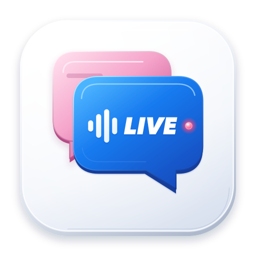

# LiveCopilot



**English** · [繁體中文](README.zh-Hant.md) · [简体中文](README.zh-Hans.md)

**Follow the conversation. Find your evidence. Answer in your own words.**

A native macOS assistant for interviews, meetings and academic discussions. LiveCopilot transcribes speech, retrieves relevant passages from your documents and streams answer suggestions in a floating window. You can also type a question without starting the microphone.

[Download 2.7.0](https://github.com/carey-bk/LiveCopilot/releases/tag/v2.7.0) · [Product website](https://carey-bk.github.io/LiveCopilot/en/) · [Release notes](docs/releases/2.7.0.md)

## Download and requirements

**2.7.0 · 38.38 MB · Universal macOS app · Developer ID signed and Apple notarized**

[Download DMG — Hong Kong mirror](https://livecopilot-downloads-hk.oss-cn-hongkong.aliyuncs.com/releases/v2.7.0/LiveCopilot-2.7.0-macOS-universal.dmg) · [GitHub download and checksums](https://github.com/carey-bk/LiveCopilot/releases/tag/v2.7.0)

| Component | Requirement |
|---|---|
| Application | macOS 14 or later; Apple Silicon or Intel |
| Local Laya automatic triggering | Apple Silicon; downloaded separately |
| Apple local speech | macOS 26 or later, supported hardware and language |
| AI answers | Your own API key for a supported analysis service |

The small installer **does not contain Laya weights**. Download the models you choose in the setup guide or Settings → Services. No separate Python, Ollama or Docker installation is needed. Approximate downloads: Zipformer + VAD **200 MB**, BGE-M3 **635 MB**, Laya and its runtime **767 MB**. Installed models require additional disk space and use your Mac's memory and compute.

Open the DMG, drag LiveCopilot into Applications and launch it there. Existing users can choose **LiveCopilot → Check for Updates…** in the application menu. Normal upgrades preserve settings, API keys, documents and history; updating Laya requires a separate model download.

## What is new in 2.7?

- Compact three-line transcripts with consistent original/translation alignment and optional streaming translation.
- Zipformer English casing cleanup for more readable transcripts.
- General, mixed and knowledge-base-only answer modes; mixed mode uses general knowledge when documents are irrelevant.
- Explicit automatic-answer waiting/blocking reasons, diagnostic counters and recent events.
- Local diagnostic summaries and private support ZIP export, optionally including crash reports. Nothing is uploaded automatically.

Translation uses your configured answer provider and may incur charges. Laya model weights are unchanged in 2.7.

See the [2.7.0 release notes](docs/releases/2.7.0.md) and [validation report](docs/releases/2.7.0-validation.md) for changes, tests, notarization and download verification.

## Start your first conversation

1. **Install and open the setup guide.** Choose your interface language and usage mode. The guide can be reopened from General settings.
2. **Prepare speech and local models.** For Chinese/English, start with Zipformer. Add BGE-M3 for document retrieval and Laya for automatic triggering on Apple Silicon. Download only what you need.
3. **Connect your analysis service.** Choose OpenAI, DeepSeek, Qwen, GLM, Kimi or a compatible streaming Chat Completions endpoint, then save your API key.
4. **Add context if needed.** Import PDF, Markdown, TXT or DOCX into Knowledge. Scanned PDFs need OCR first. Rebuild document indexes after changing the embedding model.
5. **Listen or type.** In-person mode uses the microphone; remote-meeting mode captures system audio with an optional microphone. Grant the relevant macOS permissions. You can also type with listening off.
6. **Review the session.** Read answers and source passages in the floating window, then revisit questions, answers and citations in History.

`⌥H` shows or hides the floating window. Answer, recap and follow-up shortcuts are configurable. Always review important facts and citations.

## Choose where processing happens

| Stage | Available services | What leaves your Mac? |
|---|---|---|
| Speech recognition | Local Zipformer, Paraformer or Apple; OpenAI Live | Local recognition stays on-device. OpenAI Live sends audio to OpenAI. |
| Document indexing and retrieval | Local BGE-M3 or OpenAI Embeddings | BGE-M3 runs locally. OpenAI Embeddings receives indexing/query text; retrieval storage remains local. |
| Automatic response triggering | Local Laya for local speech; OpenAI Live's semantic delegation | Laya's decision runs on-device. Cloud speech follows its provider's data handling. |
| Answer generation and automatic titles | Your selected analysis API | Relevant question/conversation text and selected evidence; automatic titles use session Q&A context. |

For example, **Zipformer + BGE-M3 + DeepSeek** keeps speech recognition and indexing local and uses DeepSeek for answers. That combination does not require an OpenAI key. Local processing has no API usage fee; cloud services may charge your account.

## Privacy and practical limits

- API keys are stored in the local macOS Keychain. Documents, indexes and session history are stored locally. There is no LiveCopilot account or developer-operated relay server.
- Local speech does **not** mean fully offline answers: the chosen analysis provider receives relevant text. Its retention and billing policies apply. Deleting local history cannot retract earlier API requests.
- Screen-sharing/recording exclusion is optional and off by default. Verify it with the actual meeting application; settings and history remain visible to capture.
- No built-in OCR, guaranteed speaker separation, spoken AI responses or cloud backup. Laya may miss a request or trigger incorrectly. Intel app support does not imply Intel support for Laya.

[Privacy details](docs/PRIVACY.md) · [Service guide](docs/SERVICE_GUIDE.md) · [Local models](docs/LOCAL_MODELS.md)

## Development and documentation

Built with Swift/SwiftUI. Full Xcode and XcodeGen are required to build from source:

```bash
./StealthApp/scripts/test-core.sh
./StealthApp/scripts/build.sh
xcodebuild -project StealthApp/LiveCopilot.xcodeproj -scheme LiveCopilot \
  -configuration Debug -derivedDataPath StealthApp/build CODE_SIGNING_ALLOWED=NO test
```

A clean checkout builds the small app without fetching Laya weights. Native runtime dependencies are checksum-pinned. Debug uses a separate bundle identifier. Mock checks need no API key or paid requests. Distribution signing and notarization are separate steps; follow the release guide before packaging.

| Documentation | Purpose |
|---|---|
| [Architecture](docs/ARCHITECTURE.md) | Components and data flow |
| [Verification](docs/VERIFICATION.md) | Tests and evidence boundaries |
| [Model distribution](docs/MODEL_RELEASE_READINESS.md) | Model pins and release requirements |
| [Release guide](docs/RELEASING.md) | Signing, notarization, packaging and updates |
| [Report an issue](https://github.com/carey-bk/LiveCopilot/issues) | Include app/macOS versions and model diagnostics; omit keys and private conversation text |

Technical documentation is maintained in English. These three README editions describe the same release; the app's interface languages remain Simplified Chinese and English.

## Credits and license

Derived from [vortechron/stealth](https://github.com/vortechron/stealth), preserving upstream Git history and the [MIT license](LICENSE). Runtime dependencies retain their own license notices. [Author: carey-bk](https://github.com/carey-bk).

---

[English](README.md) · [繁體中文](README.zh-Hant.md) · [简体中文](README.zh-Hans.md)
